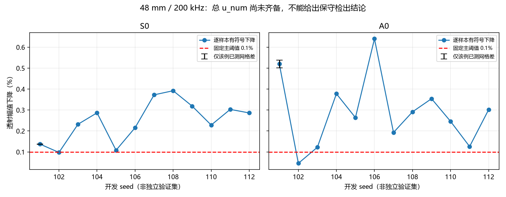
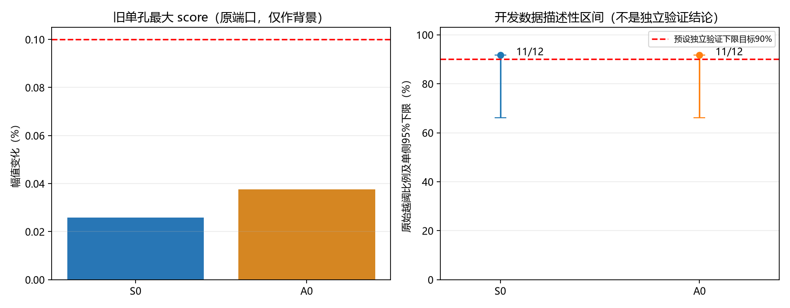

# 200 kHz、S0/A0、48 mm 验证报告

更新时间：2026-11-04T07:52:41.196128+00:00

当前运行状态：imported_snapshot_not_running。P0 已完成；后续阶段只按实际验收记录标记，不把排队或预备脚本视为已经求解。

主阈值固定为无量纲 0.001，即相对参考幅值的 0.1%。loss=1−|T| 保留符号；score=|1−|T||。所有 T 均由双入射矩阵去混合后，除以同端口无孔参考。

|模态|开发集逐样本原始越阈数|开发数据描述性单侧95%下限|相干集合下降|单样本下降均值|旧单孔最大 score|
|---|---:|---:|---:|---:|---:|
|S0|11/12|66.132%|0.254963%|0.248178%|0.025817%|
|A0|11/12|66.132%|0.303929%|0.290080%|0.037545%|

P1 completed entries indicate numerical acceptance, not necessarily threshold exceedance. Read per_case_metrics for each mode and specimen.

11/12 的描述性下限约66.1%，不能宣称已达到90%的可靠越阈目标。旧单孔使用其原匹配参考；其孔纵向位置和端口不是新48 mm控制配置，所以只作为开发背景。低响应 seed102 完整保留。

## 数值证据与缺项

|代表性 seed101 的既有48 mm网格对照|幅值差（百分点）|非零损失相对变化|相位差（°）|
|---|---:|---:|---:|
|S0|0.000706212|0.514%|0.000331917|
|A0|0.0189665|3.648%|0.0308026|

上表只覆盖 seed101 的该网格对照，不能充当所有模型的误差上界。完整 u_num 尚需逐模型网格、吸收区和提取敏感性；缺少项时不填零，不给保守检出结论。
原有限元模型通常只存最后频率的 A0 场；S0 先复用原始端口数组，不能用 A0 场替代。8 mm 已通过瞬态结果仅复用实现与设置，不作为48 mm验收证据。
形貌上游仅可追溯到固定折线库；本轮限定为固定折线几何条件下的验证，不把加密插点称为独立轮廓收敛。

## 固定独立验证规则

新样本已冻结为 113–142，共30个。P1/P2通过之前仅生成几何，不计算或查看这些样本的 T。
精确单侧95%二项下限：30/30 为 90.497%，29/30 为 85.140%。预设目标为下限≥90%；不追加种子、换样本或挑选模态。
S0/A0 分开验收，数值误差使分类待定时保守计为未成功。旧12个开发样本不进入固定30个独立验证分母。

## 阶段状态

- P0：complete；通过标记 True。
- P1：paused_snapshot；通过标记 None。
- P2：pending；通过标记 None。
- P3：pending；通过标记 None。
- P4：requires_experimental_data；通过标记 None。

## 实验适用性（P4）

缺少实测噪声、重复拆装/耦合数据、传感器电压及孔径/频响模型、温度与增益变化、实测材料卡/铺层/阻尼、三维孔形及孔隙真值。四场变量理想投影不能直接视为单个传感器电压。

实验应先在独立无孔校准数据上锁定阈值，目标误报率≤5%；再用未参与校准的数据估计误报率及其单侧95%上限。孔群实验POD目标为单侧95%下限≥90%；单孔低检出能力需另设例如单侧95%上限≤10%的目标，两者使用相同设备、平均次数和检测规则。
实测阈值高于0.1%时必须按真实阈值重判；指标或设备改变后重新校准并独立验证。没有这些数据时，不添加合成白噪声冒充实验验证。

本轮最终结论最多涉及固定二维示例材料、孔形生成分布和示例阈值下的数值越阈能力。反射、转换和相位另列，不能将单孔透射低于阈值写成所有通道不可检测。

[逐模型数值](per_case_metrics.csv) · [完整机器可读指标](per_case_metrics.json) · [复用与来源哈希](reuse_manifest.json) · [冻结协议](protocol.json)

